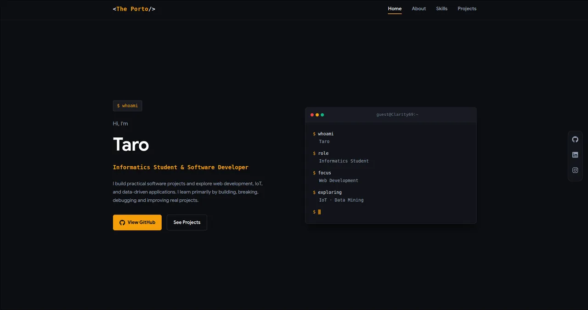

<div align="center">

# ThePorto

**A terminal-inspired developer portfolio built with React + Vite**

[](https://react.dev/)
[](https://vite.dev/)
[](https://myporto-mocha-ten.vercel.app/)
[](./LICENSE)

[**View Live Site »**](https://myporto-mocha-ten.vercel.app/)



</div>

---

##  Features

- **Light / dark theme with React Context** — global theme state via `ThemeContext` + a custom `useTheme()` hook, saved in `localStorage` and synced with the OS color scheme. A small inline script in `index.html` applies the theme before React loads, so there is no flash on reload.
- **Smooth theme transition** — a circular reveal from the toggle button using the View Transitions API, with a simple color fade as fallback and no animation for users who prefer reduced motion.
- **Gruvbox color palette** — every color is a CSS variable, so both themes come from one set of design tokens.
- **Live GitHub data** — repositories are fetched from the GitHub REST API through a custom `useGithubRepos` hook, cached in `localStorage`, with loading skeletons and a static fallback list when the API is unavailable or rate-limited.
- **Hierarchical projects section** — one spotlight project, a grid of key projects, and a compact list of everything else, each opening an accessible detail modal (keyboard support, `Esc` to close, focus returns to the item you opened).
- **Responsive** — mobile navigation menu and layouts tuned from small phones to wide desktops.
- **Performance & accessibility** — WebP images with smaller thumbnails for cards, lazy-loaded images, scroll-reveal animations via `IntersectionObserver`, ARIA labels, and visible keyboard focus.

## Tech Stack

| Area | Tools |
|---|---|
| Framework | React 19, Vite 8 |
| Styling | CSS Modules + CSS custom properties |
| Icons | react-icons |
| Data | GitHub REST API |
| Tooling | ESLint (incl. `eslint-plugin-react-hooks`) |
| Hosting | Vercel (+ Vercel Analytics) |

##  Project Structure

```
src/
├── components/     # CSS Modules for each section
├── context/        # ThemeContext, ThemeProvider, useTheme
├── data/           # projectsData, skillsData, hobbiesData
├── hooks/          # useGithubRepos (GitHub API + cache)
├── sections/       # Navbar, Hero, About, Skills, Projects, Connect, Footer, ...
├── App.jsx
├── index.css       # global styles & theme tokens
└── main.jsx
public/
└── projects/       # project screenshots (+ thumbs/ for smaller card images)
```

## Getting Started

**Requirements:** Node.js 20+ and npm.

```bash
git clone https://github.com/Clarity69/ThePorto.git
cd ThePorto
npm install
npm run dev
```

Then open http://localhost:5173.

| Script | Description |
|---|---|
| `npm run dev` | Start the dev server with hot reload |
| `npm run build` | Build for production into `dist/` |
| `npm run preview` | Serve the production build locally |
| `npm run lint` | Run ESLint |

## Customizing

Most content lives in plain data files, so you rarely need to touch components:

- **Projects** — `src/data/projectsData.js`
  - `featuredProjects`: hand-picked projects (the first one becomes the spotlight card).
  - `previewImages`: screenshots for repositories listed under *Other projects*.
  - `hiddenRepos`: repositories to hide from the live GitHub list.
- **Skills** — `src/data/skillsData.js`
- **GitHub username** — `GITHUB_USER` in `src/sections/Projects.jsx`
- **Theme colors** — the `:root[data-theme='dark']` and `:root[data-theme='light']` blocks in `src/index.css`

**Adding a project image:** put a `.webp` file in `public/projects/`, then generate the smaller card version:

```bash
mkdir -p public/projects/thumbs
for f in public/projects/*.webp; do
  magick "$f" -resize '640x>' -quality 78 "public/projects/thumbs/$(basename "$f")"
done
```

## Deployment

The site is deployed on [Vercel](https://vercel.com/). Every push to `main` triggers a production deploy, and every pull request gets its own preview URL. Build settings are defined in `vercel.json`.

## License

Released under the [MIT License](./LICENSE).

## Author

**Ahmad Taroqi (Taro)** — Informatics student at STITEK Bontang

[](https://github.com/Clarity69)
[](https://www.linkedin.com/in/ahmad-taroqi)
[](https://www.instagram.com/taroqi_/)